# 🚀 [Tips Hindawi](https://www.tipshindawi.com/) Internship (August–October) 2026

> 🎓 This project was built during the [**Tips Hindawi**](https://www.tipshindawi.com/) **Internship (August–October) 2026**.

## 👤 Participant

| Field            | Value |
| ---------------- | ----- |
| Full Name        | **Mai Nabil** |
| Project Name     | **FreshFlow AI – AI Food Waste Reduction System** |
| GitHub Username  | [**Mai732**](https://github.com/Mai732) |
| Internship Batch | August–October 2026 |
| Training Program | Large Language Models (LLMs) Program |
| Organization     | [**Edrak for Ai**](https://edrak4ai.com/en) |

---

# 📖 Project Overview

**FreshFlow AI** is an AI-powered food waste reduction system designed for supermarkets and restaurants.

The system helps users identify products that may expire or remain unsold by combining:

- **Demand Forecasting**
- **Waste Risk Analysis**
- **RAG (Retrieval-Augmented Generation)**
- **Agent Workflows**
- **Structured Output Parsing**
- **Live Inventory Management**
- **Conversational AI**

The main goal is to reduce food waste by predicting future demand, detecting slow-moving or near-expiration products, and recommending practical actions such as discounts, FEFO prioritization, and order adjustments.

The system uses historical perishable-goods data for model training and also supports live supermarket operations such as adding new products, restocking existing products, recording sales, and tracking inventory batches with different expiration dates.

---

# ✨ Features

* 📊 **Demand Forecasting**  
  Uses a LightGBM model to estimate future product demand.

* ⚠️ **Waste Risk Detection**  
  Calculates waste risk using current quantity, predicted demand, expiration time, slow-moving behavior, and historical waste.

* ⏰ **Expiration Monitoring**  
  Detects products and batches that are close to expiration.

* 🐢 **Slow-Moving Product Detection**  
  Uses historical and live sales behavior to identify low-selling products.

* 💸 **Discount Recommendations**  
  Suggests discount percentages based on waste risk and expiration urgency.

* 📦 **Order Adjustment Recommendations**  
  Recommends reducing future orders when excess inventory is detected.

* 🔄 **FEFO Inventory Management**  
  Uses **First Expired, First Out (FEFO)** so the earliest-expiring batch is sold first.

* 🆕 **New Product Support**  
  Allows completely new supermarket products to be added through the GUI.

* 📥 **Restocking Support**  
  Existing products can be restocked as separate inventory batches with their own expiration dates.

* 🛒 **Live Sales Recording**  
  Recorded sales reduce current inventory and are stored for future analysis.

* 🧠 **Cold-Start Forecasting**  
  New products without historical SKU data can still receive predictions using available features such as category, shelf life, storage type, price, and expiration information.

* 📚 **FDA RAG System**  
  Retrieves relevant information from the **FDA Food Code 2022** using semantic search.

* 🤖 **Agent Workflow**  
  Uses LangGraph to coordinate forecasting, risk analysis, RAG retrieval, recommendation generation, and output validation.

* 💬 **AI Chat Assistant**  
  Managers can ask natural-language questions such as:
  - "Which products should I discount?"
  - "Which products expire within 3 days?"
  - "Which products have the highest waste risk?"
  - "Analyze BAK_BAG_101"
  - "Predict demand for BAK_BAG_101 for 5 days"
  - "What does the FDA say about date marking?"

* ✅ **Structured Output Parsing**  
  Uses Pydantic to validate the final AI response.

* 🌐 **FastAPI Backend**  
  Exposes the AI system through API endpoints.

* 🖥️ **Streamlit GUI**  
  Provides a simple chat interface and live inventory management system.

* 🔗 **ngrok Support**  
  Allows the local Streamlit application to be shared through a public URL for demonstrations.

---

# 🧠 System Architecture

```text
Historical Kaggle Dataset
        │
        ├── Historical Sales
        ├── Historical Waste
        └── Model Training
                │
                ▼
           LightGBM Model
                │
                │
Live Products ──┤
Live Inventory ─┤
Live Sales ─────┤
                │
                ▼
        Demand Forecasting
                │
                ▼
          Waste Risk Engine
                │
                ▼
             FDA RAG
                │
                ▼
        LangGraph Workflow
                │
                ▼
         OpenAI LLM Agent
                │
                ▼
        Pydantic Output
                │
                ▼
          FastAPI Backend
                │
                ▼
         Streamlit Chat GUI
```

---

# 📂 Project Structure

```text
food-waste-ai/
│
├── agents/
│   ├── chat_agent.py
│   ├── recommendation_agent.py
│   ├── state.py
│   ├── tools.py
│   └── workflow.py
│
├── api/
│   └── main.py
│
├── data/
│   ├── raw/
│   ├── processed/
│   ├── official_guidelines/
│   ├── knowledge_base/
│   ├── live_products.csv
│   ├── live_inventory.csv
│   └── live_sales.csv
│
├── forecasting/
│   ├── features.py
│   ├── predict.py
│   └── train.py
│
├── rag/
│   ├── build_index.py
│   └── retriever.py
│
├── risk_engine/
│   ├── recommendations.py
│   └── risk.py
│
├── schemas/
│   └── output.py
│
├── models/
│
├── app.py
├── clean_data.py
├── data_analysis.py
├── live_inventory.py
├── requirements.txt
├── .env
└── README.md
```

> The live CSV files are created automatically when the user adds products, restocks inventory, or records sales.

---

# 🛠️ Technologies Used

| Technology | Purpose |
| ---------- | ------- |
| **Python** | Main programming language |
| **Pandas** | Data cleaning, processing, and analysis |
| **NumPy** | Numerical operations |
| **LightGBM** | Demand forecasting |
| **Scikit-learn** | Model evaluation and preprocessing support |
| **ChromaDB** | Vector database for RAG |
| **Sentence Transformers** | Document embeddings |
| **PyPDF** | FDA PDF text extraction |
| **LangChain** | LLM integration |
| **LangGraph** | Agent workflow orchestration |
| **OpenAI API** | AI recommendation explanations and chat routing |
| **Pydantic** | Structured output validation |
| **FastAPI** | Backend API |
| **Uvicorn** | FastAPI server |
| **Streamlit** | User interface |
| **Requests** | Communication between Streamlit and FastAPI |
| **ngrok / pyngrok** | Public demo access |

---

# 📊 Data Sources

## Perishable Goods Management Dataset

The project uses the **Perishable Goods Management** dataset from Kaggle as historical training and evaluation data.

The dataset includes information related to:

- Product IDs
- Product categories
- Transaction dates
- Expiration dates
- Initial quantities
- Units sold
- Units wasted
- Shelf life
- Storage conditions
- Product prices
- Waste percentages
- Waste costs

The historical dataset is preserved and is not overwritten by live supermarket updates.

## FDA Food Code 2022

The RAG knowledge base uses the **FDA Food Code 2022** as an authoritative source for topics such as:

- Food storage
- Temperature control
- Date marking
- Safe handling
- Holding requirements
- Disposal guidance

The PDF is automatically processed into chunks, converted to embeddings, and stored in ChromaDB.

---

# ⚙️ Installation

## 1. Clone the repository

```bash
git clone https://github.com/Mai732/<YOUR-REPOSITORY-NAME>.git
cd <YOUR-REPOSITORY-NAME>
```

Replace `<YOUR-REPOSITORY-NAME>` with the actual repository name.

## 2. Create a virtual environment

```bash
python -m venv .venv
```

### Windows

```powershell
.\.venv\Scripts\Activate.ps1
```

### macOS / Linux

```bash
source .venv/bin/activate
```

## 3. Install dependencies

```bash
pip install -r requirements.txt
```

## 4. Create the `.env` file

Create a `.env` file in the project root:

```env
OPENAI_API_KEY=your_openai_api_key_here
```

> Never upload your real API key to GitHub.

## 5. Add the datasets

Place the Kaggle CSV inside:

```text
data/raw/
```

Place the FDA Food Code PDF inside:

```text
data/official_guidelines/
```

## 6. Clean the historical data

```bash
python clean_data.py
```

## 7. Build forecasting features

```bash
python forecasting/features.py
```

## 8. Train the LightGBM model

```bash
python forecasting/train.py
```

## 9. Build the RAG vector database

```bash
python rag/build_index.py
```

---

# 🚀 Usage

For development, run FastAPI and Streamlit in two terminals.

## Terminal 1 — FastAPI

```bash
uvicorn api.main:app --reload
```

FastAPI will run at:

```text
http://127.0.0.1:8000
```

API documentation:

```text
http://127.0.0.1:8000/docs
```

## Terminal 2 — Streamlit

```bash
streamlit run app.py
```

Streamlit will normally open at:

```text
http://localhost:8501
```

---

# 💬 AI Assistant Examples

The AI assistant can answer questions such as:

```text
Which products should I discount?
```

```text
Which products expire within 3 days?
```

```text
Which products have the highest waste risk?
```

```text
Analyze BAK_BAG_101
```

```text
Predict demand for BAK_BAG_101 for 5 days
```

```text
What does the FDA say about date marking?
```

```text
What does the FDA say about refrigerated ready-to-eat food?
```

---

# 📦 Live Supermarket Management

The Streamlit GUI also contains an **Inventory Management** section.

## Add New Product

Use this for a product that has never existed in the supermarket before.

The user can enter:

- Product ID
- Product name
- Category
- Storage type
- Shelf life
- Initial quantity
- Cost price
- Selling price
- Received date
- Expiration date

The information is stored in:

```text
data/live_products.csv
data/live_inventory.csv
```

## Restock Existing Product

Each restock is stored as a **new batch**.

Example:

```text
Milk Batch A
20 units
Expires October 8

Milk Batch B
50 units
Expires October 15
```

The system keeps both expiration dates separately.

## Record Sale

When a product is sold:

1. Current inventory is reduced.
2. The earliest-expiring batch is reduced first using **FEFO**.
3. The transaction is stored in:

```text
data/live_sales.csv
```

The AI can use recorded live sales as additional operational information.

---

# 🧪 AI Pipeline

For a normal product analysis:

```text
Product
   ↓
Live + Historical Data
   ↓
LightGBM Demand Forecast
   ↓
Waste Risk Engine
   ↓
FDA RAG Retrieval
   ↓
LangGraph Agent
   ↓
OpenAI Explanation
   ↓
Pydantic Validation
   ↓
Structured Response
```

Example output:

```json
{
  "product": "Milk",
  "current_quantity": 50,
  "expiration_risk": "HIGH",
  "predicted_demand": 23,
  "waste_risk": "HIGH",
  "recommended_discount": 30,
  "recommended_order_adjustment": -20
}
```

---

# 📐 Waste Risk Logic

The system combines several signals:

```text
Waste Risk =
50% Expected Surplus Risk
+ 25% Expiration Risk
+ 15% Slow-Moving Risk
+ 10% Historical Waste Risk
```

The risk categories are:

```text
0.00 – 0.29 → LOW
0.30 – 0.59 → MEDIUM
0.60 – 0.79 → HIGH
0.80 – 1.00 → CRITICAL
```

The Risk Engine performs the numeric calculations instead of asking the LLM to invent scores.

---

# 📈 Results

The completed system can:

- Predict future product demand.
- Detect inventory that may remain unsold.
- Identify products approaching expiration.
- Detect slow-moving products.
- Calculate structured waste-risk scores.
- Recommend product discounts.
- Recommend future order reductions.
- Support FEFO inventory rotation.
- Retrieve relevant FDA Food Code guidance.
- Handle existing supermarket products.
- Handle completely new products using cold-start prediction.
- Track new inventory batches and expiration dates.
- Record live sales.
- Provide answers through a conversational AI assistant.
- Return validated structured outputs.

> Model accuracy and waste-reduction percentages should be reported using the actual evaluation results produced by your training run rather than hard-coded values.

---

# 📸 Demo

Below are screenshots from the FreshFlow AI interface showing the main features of the system.

## 💬 AI Assistant

### Main Chat Interface

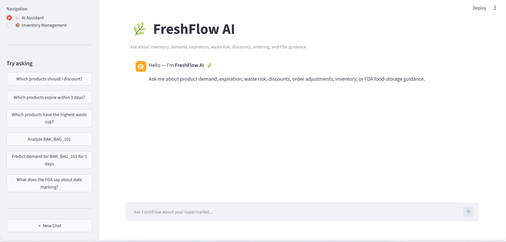

### Expiring Products Search

The assistant can identify live inventory batches that are approaching their expiration date.

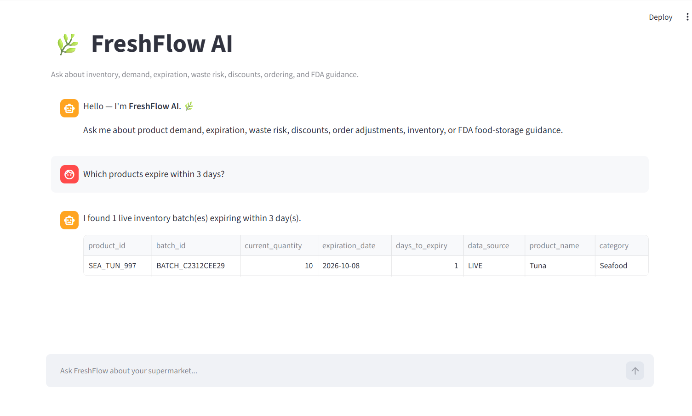

### Product Waste-Risk Analysis

FreshFlow AI combines inventory status, predicted demand, expiration risk, waste risk, discount recommendations, and order adjustments in one structured analysis.

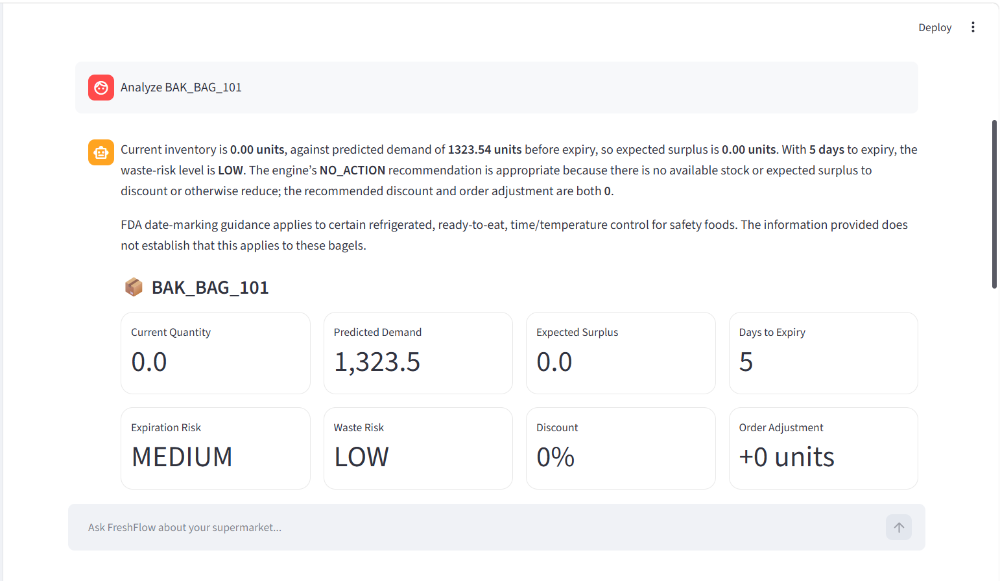

### FDA Evidence Used in Product Analysis

The system retrieves supporting evidence from the FDA Food Code through the RAG pipeline.

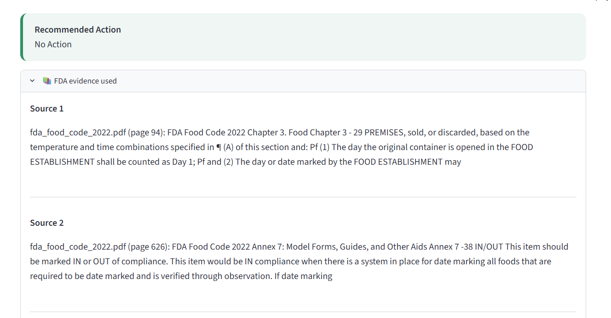

### FDA Date-Marking Question

Managers can ask direct food-safety questions and receive answers grounded in retrieved FDA Food Code passages.

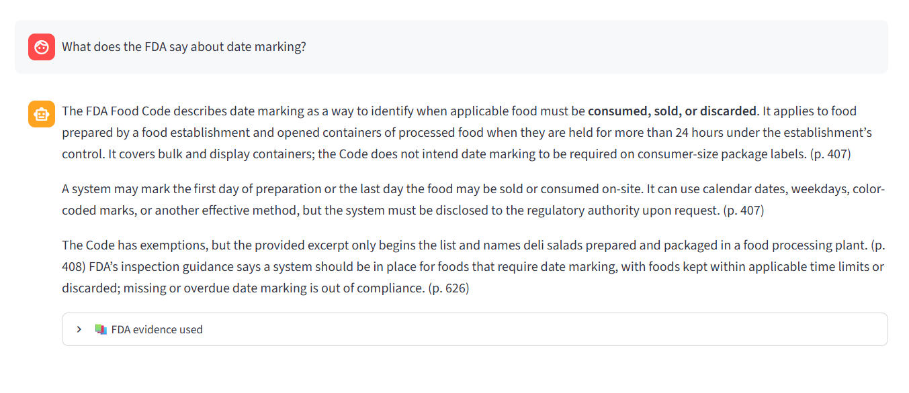

## 📈 Demand Forecasting

### Five-Day Demand Forecast

The AI assistant can generate multi-day demand predictions for a selected product.

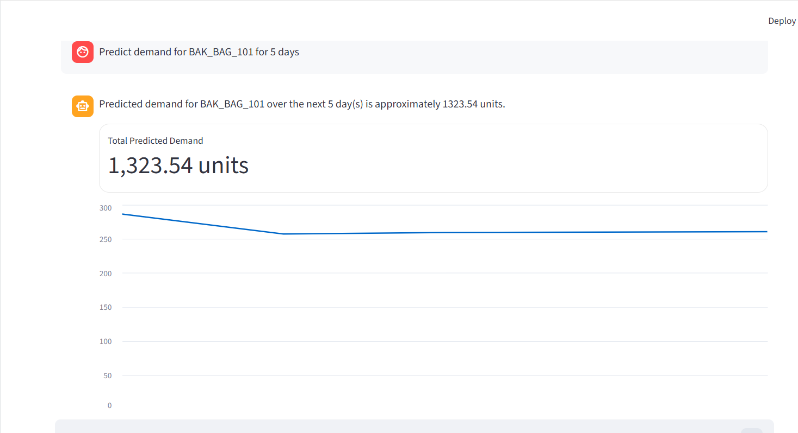

### Forecast Values

Daily prediction values are also shown in a structured table.

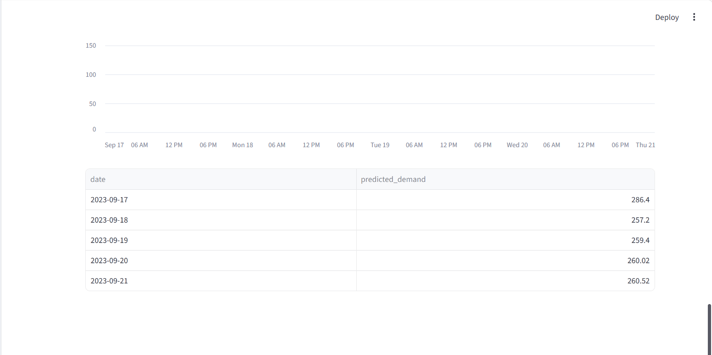

## 📦 Inventory Management

### Add a Brand-New Product

New products can be entered directly through the Streamlit interface.

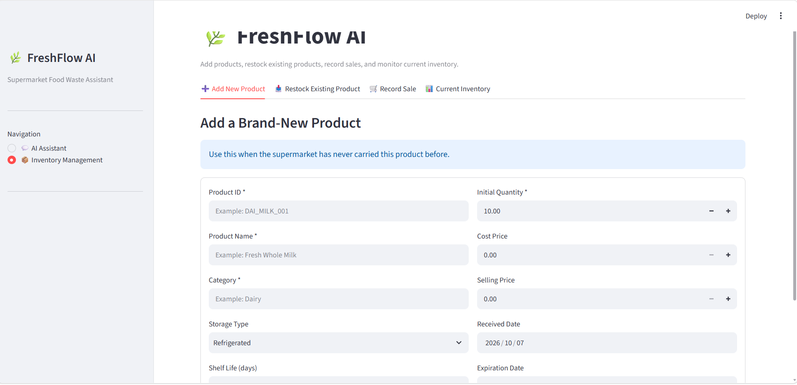

### New Product Added Successfully

The system creates the product and its first live inventory batch.

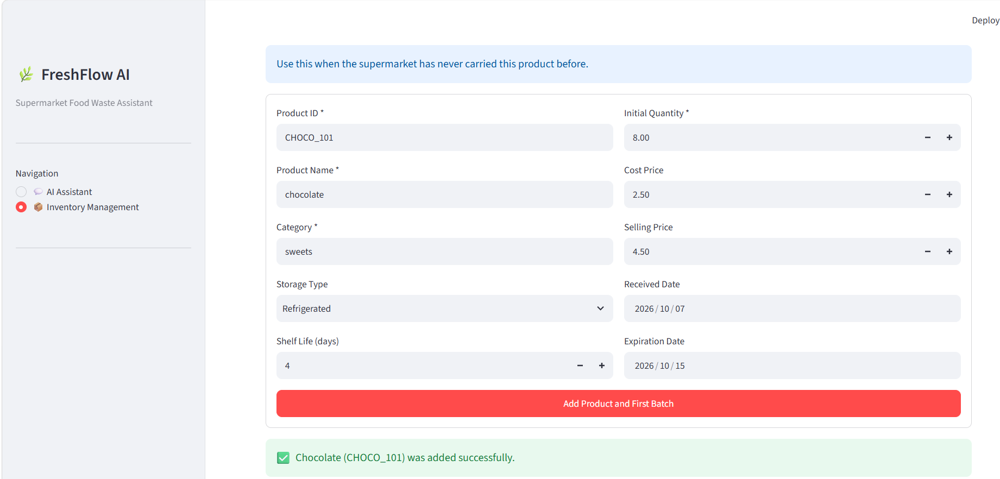

### Restock an Existing Product

Every restock is stored as a separate batch so different expiration dates can be tracked correctly.

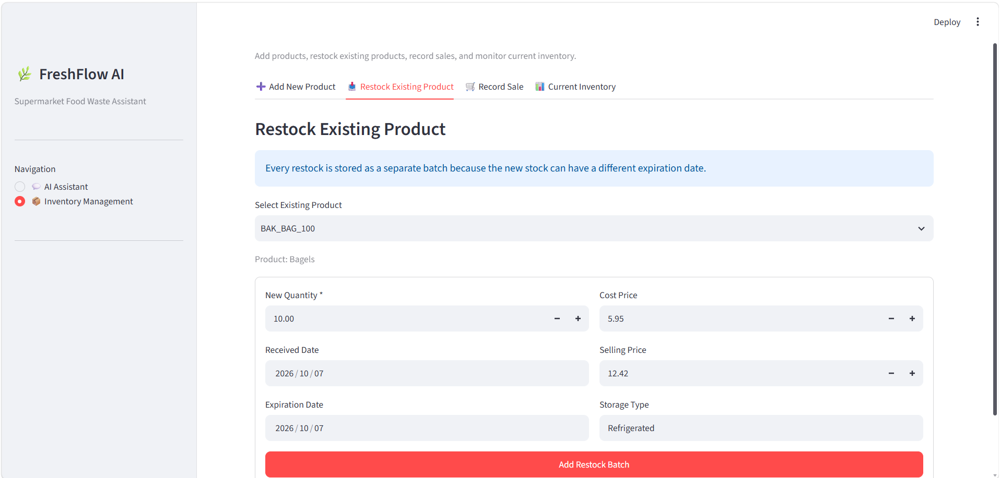

### Existing Product Selection

Historical and live products can be selected for restocking.

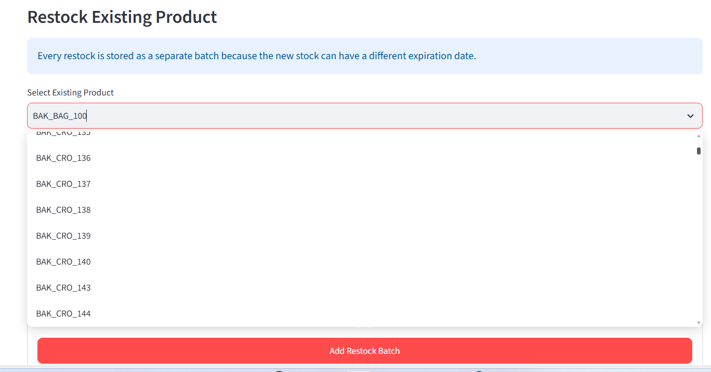

### Record a Product Sale

Sales are recorded from the GUI, and FreshFlow AI applies FEFO so the earliest-expiring stock is reduced first.

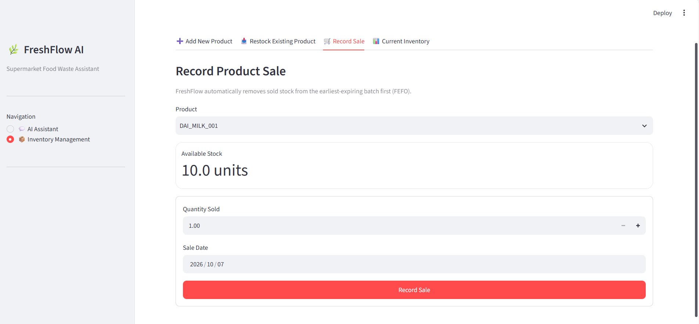

### Inventory Updated After a Sale

The available quantity changes immediately after the sale is recorded.

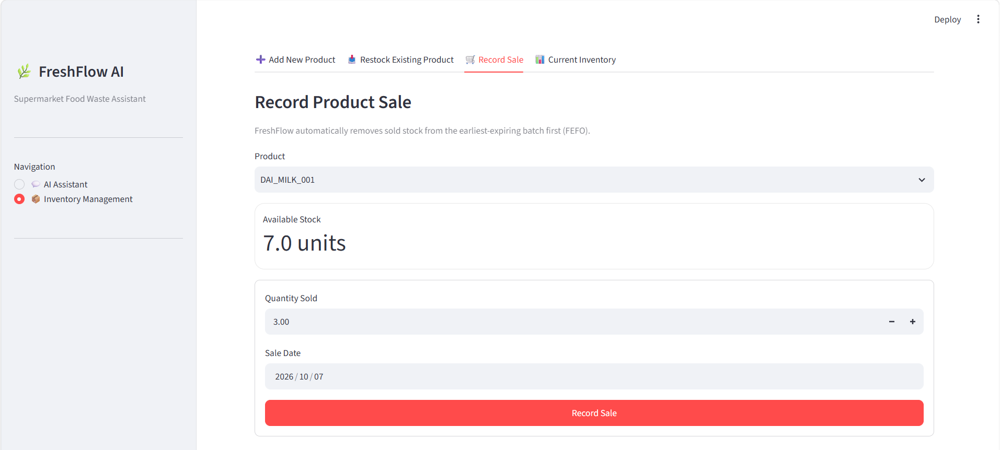

### Current Live Inventory

The inventory dashboard shows active products, current units, products expiring within three days, and live product details.

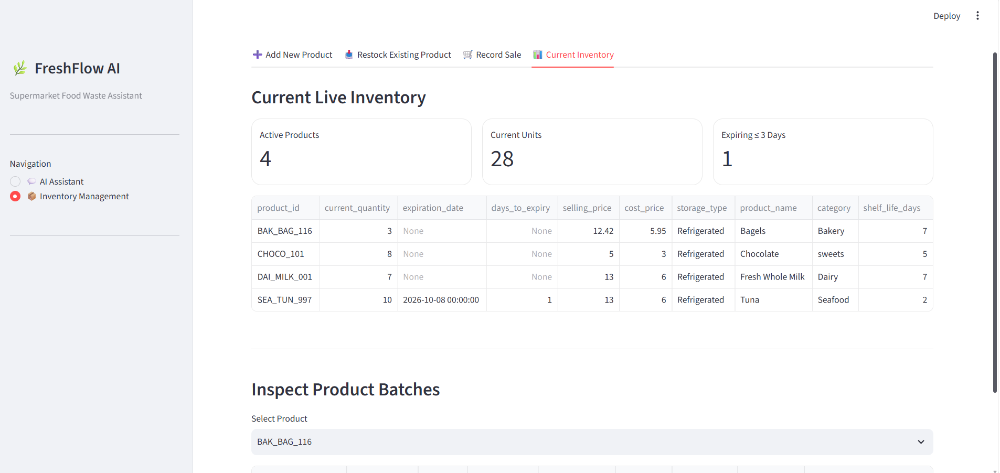

### Inspect Product Batches

Individual inventory batches can be inspected separately, including quantity, dates, prices, and storage type.

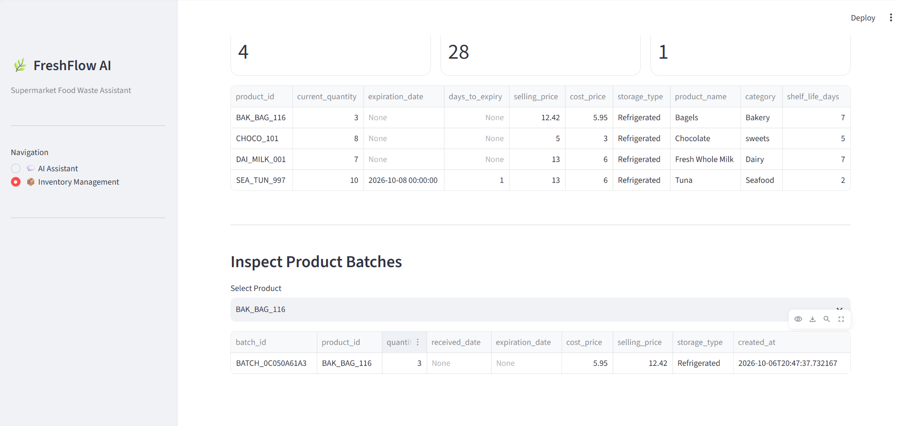

---


# 🔮 Future Improvements

* Connect directly to a real supermarket POS and inventory management system.
* Replace CSV-based live storage with PostgreSQL or another production database.
* Automatically import sales transactions instead of entering them manually.
* Automatically import supplier deliveries and purchase orders.
* Add branch-level inventory transfer recommendations.
* Add holiday and event features to demand forecasting.
* Add weather information for products affected by seasonal demand.
* Add forecast confidence intervals.
* Add notification alerts for products approaching expiration.
* Add manager dashboards for waste cost, savings, and sustainability metrics.
* Retrain the forecasting model automatically as new live sales accumulate.
* Add authentication and role-based access for supermarket employees.

---

# 🌱 About FreshFlow AI

**FreshFlow AI** was created by **Mai Nabil** as an AI-powered supermarket food-waste reduction system.

The project brings together machine learning, live inventory management, retrieval-augmented generation, agent workflows, and a conversational interface in one end-to-end application.

Its purpose is to help supermarket managers make better operational decisions by answering practical questions such as which products are close to expiration, which items may create excess stock, what should be discounted, how future orders should be adjusted, and what relevant FDA guidance applies.

Unlike a dashboard built only from static historical data, FreshFlow AI also supports live supermarket activity. New products can be added, existing products can be restocked in separate batches, sales can be recorded using FEFO inventory rotation, and the AI assistant can analyze the latest inventory state.

The project is available on GitHub under the username [**Mai732**](https://github.com/Mai732).


